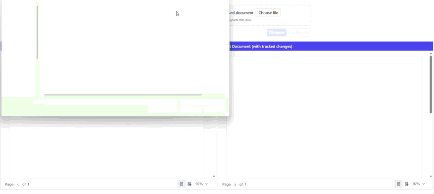

# React DOCX Editor – Compare Original and Revised Documents

## Introduction

This sample contains a React application that demonstrates how to compare two Word documents using the Syncfusion<sup style="font-size:70%">&reg;</sup> [React DOCX Editor](https://www.syncfusion.com/docx-editor-sdk/react-docx-editor?utm_source=github&utm_medium=listing&utm_campaign=github-github-documenteditor-examples) (Document Editor). The sample allows users to upload an original and a revised document, compare them using the Document Editor web service, and view the comparison results with revision tracking.

### Features

- Upload an original Word document.
- Upload a revised Word document.
- Compare both documents.
- View tracked revisions in the comparison result.
- Switch between:
  - Original vs Compared document
  - Original vs Revised document

---

# How to Run the Application

## Prerequisites

Before running the sample, ensure the following software is installed:

- Node.js (LTS)
- npm

---

## Configuration

No additional configuration is required.

This sample is already configured to use the online Syncfusion Document Editor service:

```ts
const serviceUrl =
  "https://document.syncfusion.com/web-services/docx-editor/api/documenteditor/"; //only for demo purpose.
```

Since the application consumes the hosted web service, you do **not** need to download, build, or run any ASP.NET Core Web API project.

---

## Install Dependencies

Open the project folder in a terminal and install the required packages.

```bash
npm install
```

---

## Run the Application

Start the React development server.

```bash
npm start
```

The application will launch in your default browser.

If it does not open automatically, browse to:

```
http://localhost:3000
```

---

## Verify the Sample

1. Launch the application.
2. Click **Browse** under **Original Document** and select a DOCX file.
3. Click **Browse** under **Revised Document** and select another version of the same document.
4. Click **Compare**.
5. The application sends both documents to the online Document Editor service.
6. The comparison result is displayed in the right-side editor with tracked revisions.
7. Toggle between:
   - **Original vs Compared**
   - **Original vs Revised**
8. Review insertions, deletions, and formatting changes using the Document Editor revision features.

---
## Demo

<p align="center">
  
</p>

---
# Project Workflow

The application follows the workflow below:

1. User uploads the original document.
2. User uploads the revised document.
3. Both documents are sent to the Syncfusion online Document Editor service.
4. The service:
   - Imports the DOCX files.
   - Compares both documents.
   - Generates a document with tracked revisions.
5. The comparison result is returned in SFDT format.
6. The React application loads the original document in the left editor.
7. The compared document (or revised document) is loaded in the right editor for side-by-side review.

```
Original DOCX
        │
        │
        ▼
React Application
        │
        │
        ▼
Syncfusion Online Document Editor Service
        │
        ├── Import Original
        ├── Import Revised
        └── Compare Documents
                │
                ▼
      Compared SFDT Document
                │
                ▼
React DOCX Editor
        │
        ├── Left Editor  → Original
        └── Right Editor → Compared / Revised
```

---
