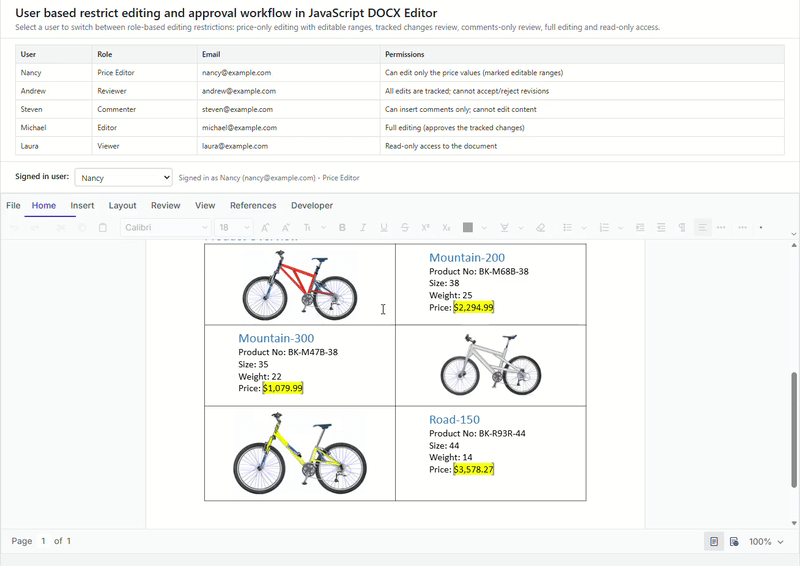

# User-based restrict editing and approval workflow in React DOCX Editor (Document Editor)

This sample demonstrates the user-based document restrictions and approval workflows of the [Syncfusion&reg; React DOCX Editor](https://www.syncfusion.com/docx-editor-sdk/react-docx-editor?utm_source=github&utm_medium=listing&utm_campaign=github-react-docx-editor-examples) (Document Editor). The loaded Adventure Works Cycles document contains user-based editable ranges for Nancy's price values, and each user's restrictions are applied on the fly when a user is selected from the dropdown.

## Demo

* **Nancy** (nancy@example.com) – Price Editor: can edit only the price values that are marked as editable ranges for her in the loaded document.
* **Andrew** (andrew@example.com) – Reviewer: all edits are tracked as revisions (`RevisionsOnly` protection), and he cannot accept or reject revisions.
* **Steven** (steven@example.com) – Commenter: can insert comments only (`CommentsOnly` protection) and cannot edit the document content.
* **Michael** (michael@example.com) – Editor: full editing access on the entire document (no protection applied) and reviews the tracked changes.
* **Laura** (laura@example.com) – Viewer: read-only access to the document.

Select a user in the dropdown to switch the document restrictions between the roles, and use the table above the dropdown to see each user's permissions at a glance.



## How it works

1. The sample loads the Adventure Works Cycles SFDT document from `src/assets/data-document-protection.json`. The attached SFDT already holds the user-based editable ranges (Nancy's price values) along with a ReadOnly protection (hash and salt), so it opens in the protected mode.
2. When a user is selected, the previous document protection is stopped and the protection type of the new user is enforced through `documentEditor.editorModule.enforceProtection`:
   * `RevisionsOnly` – for Andrew, so all his edits are tracked.
   * `CommentsOnly` – for Steven, so he can only add comments.
   * `NoProtection` – for Michael, so he has full editing access.
   * `ReadOnly` – for Nancy (only her editable ranges can be edited) and Laura (no editable ranges, so the document is fully read-only).
3. For Laura, the container is also set to read-only (`documentEditor.isReadOnly = true`), so the document content cannot be modified.
4. The approval workflow is demonstrated with the `beforeAcceptRejectChanges` event of the Document Editor: Andrew's accept/reject actions are cancelled, so the tracked changes can only be approved by a user with approval rights (Michael).

## How to run this sample

1. Clone the [React DOCX Editor examples](https://github.com/SyncfusionExamples/react-docx-editor-examples) repository.
2. Navigate to the `document-protection` directory and install the dependencies:

   ```
   npm install
   ```

3. Start the sample:

   ```
   npm run dev
   ```

4. Select a user in the dropdown to apply that user's document restrictions:
   * Nancy – try editing a price value (allowed) and any other text (blocked).
   * Andrew – type anywhere; the edits appear as tracked changes, and the accept/reject actions are cancelled.
   * Steven – insert comments from the Review tab; editing the content is blocked.
   * Michael – edit and format anywhere, and accept or reject Andrew's revisions.
   * Laura – the document is read-only; the content cannot be modified.

> Note: The sample uses the Syncfusion demo web service (`https://document.syncfusion.com/web-services/docx-editor/api/documenteditor/`) for demo purposes. For production, set up your own web service as described in the [web services documentation](https://help.syncfusion.com/document-processing/word/word-processor/react/web-services/?utm_source=github&utm_medium=listing&utm_campaign=github-react-docx-editor-examples).
